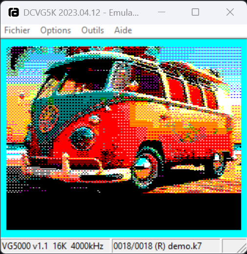

# vg5k_dither
Convertisseur d'images vers VG5000

La conversion d'images modernes (JPEG, PNG, ...) vers le [Philips VG5000](https://fr.wikipedia.org/wiki/Philips_VG5000%C2%B5) est un exercice technique très particulier en raison du processeur graphique de la machine (le [SGS Thomson EF9345](https://en.wikipedia.org/wiki/Thomson_EF9345)). Ce composant gère l'affichage en mode semi-graphique (40 colonnes × 25 lignes). Il n'y a pas de mode "bitmap" pixel par pixel classique, l'image doit être convertie en une grille de caractères redéfinis (limités à 500 caractères personnalisables en RAM de 4*10 pixels en 4 couleurs sur une palette de 8).



# prérequis (Windows)
[gcc](https://github.com/brechtsanders/winlibs_mingw/releases/download/16.2.0posix-23.1.3-14.0.0-ucrt-r3/winlibs-i686-posix-dwarf-gcc-16.2.0-llvm-23.1.3-mingw-w64ucrt-14.0.0-r3.7z)
[z88dk](https://github.com/z88dk/z88dk/releases/download/v2.4/z88dk-win32-2.4.zip)

```Powershell
cmake -G Ninja -DCMAKE_BUILD_TYPE=Debug -B .\build -DCMAKE_EXPORT_COMPILE_COMMANDS=1
copy build/compile_commands.json .
cd build
ninja
```

```
.\vg5kdf.exe ..\samples\bw.png
```

```
zcc +vg5k -create-app -o demo disp.c
```
